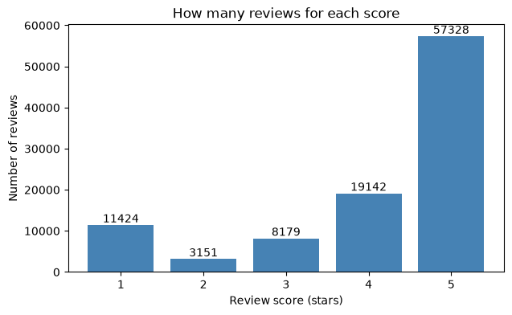
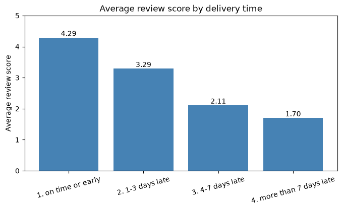
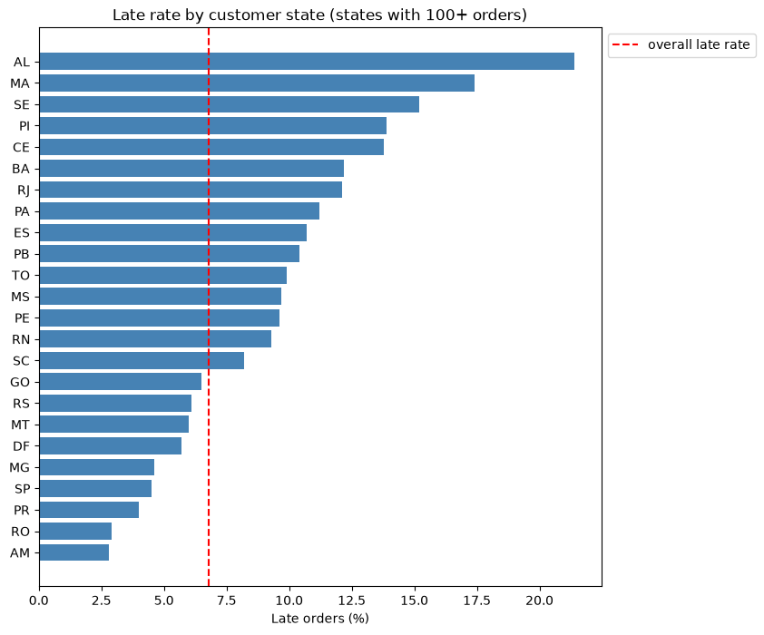
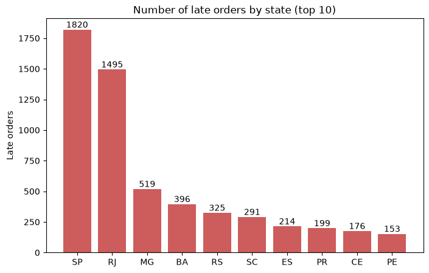
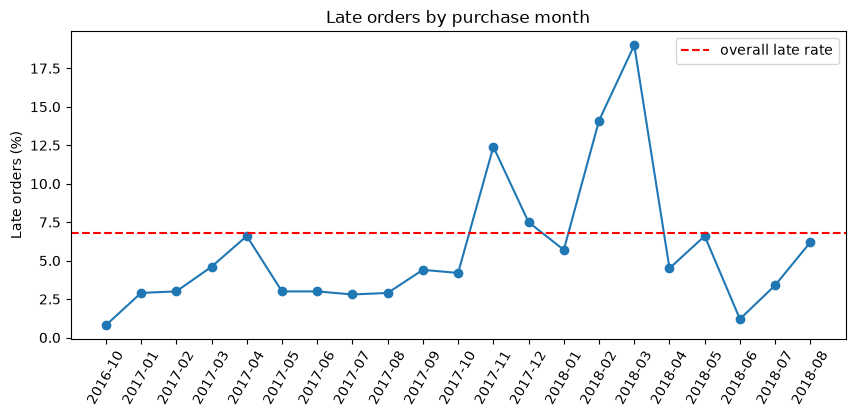
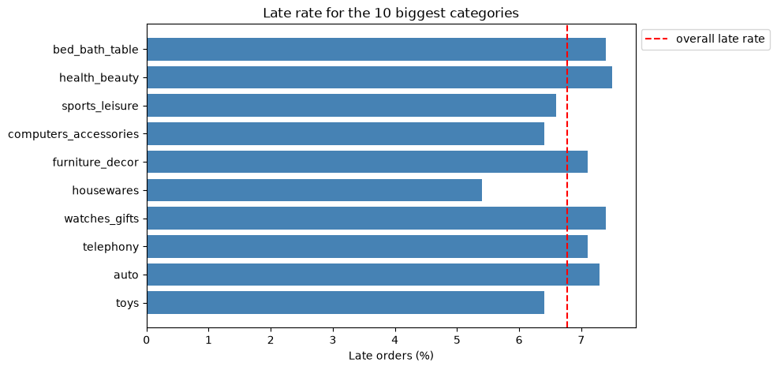

# Olist E-Commerce: Late Deliveries and Bad Reviews

**Question:** Are late deliveries linked to bad reviews, where and when is the problem biggest, and how much sales value is at risk?

## Summary

I used SQL and Python on about 99K orders from a Brazilian online marketplace. Late deliveries are rare (6.8% of delivered orders), but they are strongly linked to bad reviews. Orders that arrive more than 7 days late average 1.70 stars, against 4.29 stars for on-time orders. About 4.7% of delivered sales value (R$ 720K of R$ 15.4M) is tied to late orders that got a 1 or 2 star review. The problem depends on **where** and **when** an order is delivered, not **what** it is: the northeast states and Rio de Janeiro are late far more often than the rest, lateness spiked in a few months, and product categories look alike.

## Key findings

**Context.** The dataset has 99,224 reviews. 57.8% are 5 stars and 14.7% are 1 or 2 stars.



1. **Late deliveries are rare.** 6,534 of 96,470 delivered orders (6.8%) arrived after the promised date.
2. **Reviews drop as the delay grows.**

   | Delivery | Orders | Average review score |
   |---|---|---|
   | On time or early | 89,443 | 4.29 |
   | 1-3 days late | 1,852 | 3.29 |
   | 4-7 days late | 1,748 | 2.11 |
   | More than 7 days late | 2,781 | 1.70 |

   

3. **Late orders are often very late.** Of the 6,381 late orders that have a review, 2,781 (44%) arrived more than 7 days late.
4. **Money at risk.** 3,979 late orders got a 1 or 2 star review. Their value (price plus freight) is about R$ 720K, which is 4.7% of the R$ 15.4M of delivered sales.
5. **Location matters a lot.** Late rates run from 2.8% to 21.4% across states (states with at least 100 delivered orders).

   | State | Delivered orders | Late orders | Late % |
   |---|---|---|---|
   | AL | 397 | 85 | 21.4 |
   | MA | 717 | 125 | 17.4 |
   | SE | 335 | 51 | 15.2 |
   | PI | 476 | 66 | 13.9 |
   | CE | 1,279 | 176 | 13.8 |
   | RJ | 12,350 | 1,495 | 12.1 |
   | SP | 40,494 | 1,820 | 4.5 |

   

   - The five highest states are all in the northeast. The nine northeast states together are 12.7% late, against 6.2% for all other states.
   - 15 of the 24 states are above the overall rate of 6.8%. São Paulo (SP) has 42% of all orders and a 4.5% late rate, so it pulls the overall rate down.
   - Rate and volume tell different stories. Rio de Janeiro (RJ) has 13% of all orders but 23% of all late orders. SP and RJ together have 3,315 of the 6,534 late orders (about half).

   

6. **Late deliveries come in waves.** Before November 2017, every month was below the overall rate (most were around 3%). November 2017 and February-March 2018 were far above it, and March 2018 was the worst month, at roughly 19% late. Months with fewer than 100 delivered orders are not shown, so there is a hidden gap between 2016-10 and 2017-01.

   

7. **Product category matters much less.** 34 of 52 category groups are between 5% and 8% late, close to the overall 6.8%. The highest is audio (11.8%), but it has only 348 orders.

   

8. **Late delivery is not the only cause of bad reviews.** About 11K reviews gave 1 star, but only 6,534 orders were late.

Money values are in Brazilian reais (R$). "Money at risk" is the value of the orders, not proven lost revenue.

## Approach

1. Load the CSV files into a SQLite database with Python.
2. Check the data: order statuses, orders per month, missing dates, duplicate reviews.
3. Measure how late each order was (delivered date minus promised date).
4. Compare review scores for on-time and late orders.
5. Estimate the money at risk and its share of delivered sales.
6. Break the late rate down by customer state and by product category.
7. Re-check the SQL results in Python and draw the charts (pandas, matplotlib).
8. Build a dashboard in Tableau Public (planned).

## Queries at a glance

| Query | What it answers |
|---|---|
| 3 | How many delivered orders were late? |
| 4 | Do late orders get worse reviews? |
| 5 and 6 | How much money is in late, unhappy orders, and what share of sales is that? |
| 7 | Which states have the highest late rate? |
| 8 | Which product categories have the highest late rate? |

## Method and data checks

- **Late** means the delivery date is later than the promised date. I compare calendar days, not exact times, because the promised date has no time of day.
- **One score per order.** Some orders have more than one review row, so I average the scores for each order first.
- **Orders used.** Lateness is measured only for delivered orders that have a delivery date. 646 delivered orders have no review, so they are left out of the review comparison.
- **No double counting.** Price plus freight is added up per order before joining to reviews. For categories, each order is counted once per category with `COUNT(DISTINCT order_id)`. An order with items from two categories appears in both.
- **Small groups left out.** States, categories, and months with fewer than 100 delivered orders are excluded from the rate charts, because their percentages jump around.
- **Missing categories.** Products with no category are shown as `unknown`, so they are not silently dropped.
- **Speed.** I added indexes on `order_id`, because the joins were very slow without them.
- **SQL and Python agree.** The notebook rebuilds the late rate and the money at risk in pandas and compares them with the SQL results.

## Recommendations

These are ideas based on the findings. They are not proven fixes.

- **Start with the northeast states and Rio de Janeiro.** They have the highest late rates, and RJ has 23% of all late orders. Look at delivery routes and carriers there.
- **Plan for busy periods.** The late rate jumped in November 2017 and in February-March 2018. Extra delivery capacity, or longer delivery estimates in those periods, may help.
- **Focus on the longest delays.** Orders more than 7 days late score the lowest (1.70) and make up 44% of late orders.
- **Make delivery promises more realistic.** Even 1-3 days late costs about 1 star, so a safer estimate may protect reviews.
- **Warn customers early** when an order is going to be late, and follow up with them.
- **Do not build category-specific fixes yet.** Categories look alike. Keep an eye on audio, but its sample is small.

## Limitations

- This is a public dataset. It may not match the full business.
- A link is not proof of cause. A late order and a bad review can both come from another problem, such as a product issue.
- I did not check sellers or carriers, so I cannot say why the northeast and Rio are late more often.
- I do not know what caused the spikes. November 2017 included Black Friday, which may be one reason, but the data cannot prove it.
- Review scores are averaged per order, and orders with no review are excluded from the score comparison.
- Money at risk is an estimate. Some customers may have been refunded or may have bought again.

## Next steps

- [x] Load the data and run the first checks
- [x] Late rate, review scores by delay, money at risk
- [x] Late rate by customer state and product category
- [x] Charts in Python (pandas, matplotlib)
- [ ] Dashboard in Tableau Public
- [ ] Check whether the spikes hit all states or only some (dashboard filters)
- [ ] Optional: late rate by seller, and a basic model to predict bad reviews

## How to run

1. Download the **Brazilian E-Commerce Public Dataset by Olist** from Kaggle and put the CSV files in a folder called `data/`.
2. Install pandas (`pip install pandas`) and run `python load_data.py`. This creates `olist.db`.
3. Open `olist.db` in DB Browser for SQLite and go to the Execute SQL tab.
4. Run the index block at the top of `queries.sql` once and press Write Changes. Then run the queries one at a time. Queries 5 to 8 need the indexes to run quickly.
5. For the charts, install matplotlib and Jupyter (`pip install matplotlib jupyter`), open `olist_eda.ipynb` in the same folder as `olist.db`, and run all cells. This creates the `charts/` folder and `orders_for_dashboard.csv`.

The raw CSV files and the database are not in this repo. Download the data from Kaggle and rebuild them.

## Repo structure

```
load_data.py       loads the CSV files into olist.db
queries.sql        indexes and SQL queries 1-8
olist_eda.ipynb    Python checks and charts
charts/            chart images used in this README
README.md          this file
data/              raw CSVs (not committed, see .gitignore)
```

`olist.db` and `orders_for_dashboard.csv` are created when you run the code. They are not committed.

## Skills used

SQL (joins, LEFT JOIN, CTEs, CASE WHEN, aggregation, COUNT DISTINCT, HAVING, indexes), Python (pandas, matplotlib, Jupyter), data cleaning, data visualization, defining business metrics.

## Disclaimer

Unofficial analysis of a public dataset. Not affiliated with Olist.